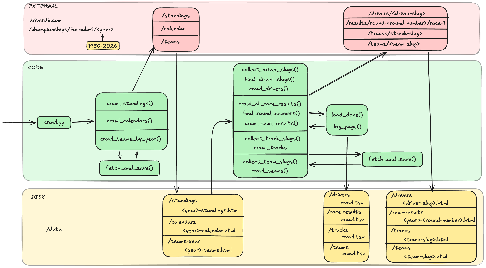

# 2a. Konzultácia – Návrh riešenia

## Frameworky a nástroje

| Nástroj | Na čo |
| --- | --- |
| Python 3.14 | jazyk celého projektu |
| `requests` | HTTP requesty (jediná externá knižnica crawlera) |
| `re` | extrakcia odkazov a slugov z HTML regexom |
| `os`, `time` | práca so súbormi, čakanie medzi requestmi |
| uv | správa virtuálneho prostredia a závislostí (`pyproject.toml`, `uv.lock`) |

Nepoužívame Scrapy ani BeautifulSoup: stránky majú jednotnú šablónu a všetky potrebné odkazy sa dajú vytiahnuť regexom. V druhej časti projektu pribudne PySpark (spracovanie dumpu Wikipédie) a PyLucene (index).

Spustenie: `uv run crawl.py`

## Architektúra crawl systému



Crawl má dva druhy stránok:

- **sezónne stránky** (jedna na rok, 1950 – 2026): `standings`, `calendar`, `teams`. Slúžia len ako zdroj odkazov.
- **stránky entít** (samotné dokumenty): jazdci, výsledky pretekov, okruhy, tímy.

Každý krok číta iba súbory uložené predchádzajúcim krokom, nie premenné v pamäti. Kroky sa dajú spúšťať samostatne a pád jedného kroku nezničí výsledky predchádzajúcich.

| Zdroj | Čo z neho extrahujeme | Cieľová stránka |
| --- | --- | --- |
| `/<rok>/standings` | slugy jazdcov (`profile_url` v JSON) | `/drivers/<slug>` |
| `/<rok>/calendar` | čísla kôl s výsledkami | `/<rok>/results/round-<n>/race-1` |
| `/<rok>/calendar` | slugy okruhov (`href="/tracks/…"`) | `/tracks/<slug>` |
| `/<rok>/teams` | slugy tímov (`href="/…/teams/…"`) | `/teams/<slug>` |

## Hlavičky, timeout, sleep

| Nastavenie | Hodnota |
| --- | --- |
| `User-Agent` | `VINF-F1-crawler/0.1 (FIIT STU student project)` |
| timeout requestu | 10 s |
| pauza medzi requestmi | 2 s (robots.txt nepredpisuje `Crawl-delay`, nechodíme na `/api/`) |
| opakovanie | max. 3 pokusy pri sieťovej chybe, 429 a 5xx, s čakaním 2 s a 4 s |
| 404, 410 a iné 4xx | bez opakovania, iba zápis do logu |

Stránku ukladáme na disk iba pri statuse 200.

## Implementácia

Celý crawler je v `crawl.py`. Funkcie sú rozdelené do štyroch skupín, v rámci skupiny majú rovnakú štruktúru a líšia sa len konštantami (URL, priečinok, log, regex):

| Skupina | Funkcie |
| --- | --- |
| sezónne stránky | `crawl_standings`, `crawl_calendars`, `crawl_teams_by_year` |
| regex nad HTML | `find_driver_slugs`, `find_round_numbers`, `find_tracks`, `find_team_slugs` |
| zber slugov zo sezón | `collect_driver_slugs`, `collect_track_slugs`, `collect_team_slugs` |
| stránky entít | `crawl_drivers`, `crawl_race_results`, `crawl_tracks`, `crawl_teams` |

Spoločné sú `fetch_and_save` (request, retry, uloženie), `log_page` a `load_done` (log).

### Pseudokód

```
fetch_and_save(url, path):
    pre pokus 1..3:
        skús GET url (User-Agent, timeout 10 s)
            200            -> ulož HTML do path, vráť odpoveď
            429 alebo 5xx  -> skús znova
            iný status     -> vráť odpoveď (neukladá sa)
        pri sieťovej chybe -> skús znova
        počkaj 2 s, potom 4 s
    vráť None

crawl_standings(): # rovnako crawl_calendars, crawl_teams_by_year
    pre každý rok 1950..2026:
        ak súbor <rok>-standings.html existuje -> preskoč
        fetch_and_save(STANDINGS_URL(rok), súbor)
        počkaj 2 s

find_driver_slugs(html): # rovnako find_tracks, find_team_slugs
    vráť set regex.findall(html) # set odstráni duplikáty

collect_driver_slugs(): # rovnako collect_track_slugs, collect_team_slugs
    slugs = prázdna množina
    pre každý rok: slugs += find_driver_slugs(obsah <rok>-standings.html)
    vráť zoradený zoznam slugs

crawl_drivers(slugs): # rovnako crawl_tracks, crawl_teams
    hotové = kľúče so statusom 200 z data/drivers/crawl.tsv
    pre každý slug:
        ak slug je v hotové -> preskoč
        odpoveď = fetch_and_save(DRIVER_URL(slug), data/drivers/<slug>.html)
        zapíš do logu: status, kľúč, cesta, url
        počkaj 2 s

crawl_all_race_results(): # kľúč je rok + kolo, preto po sezónach
    pre každý rok:
        kolá = find_round_numbers(obsah <rok>-calendar.html)
        crawl_race_results(kolá, rok) # ako crawl_drivers, kľúč "<rok>-round-<n>"

main:
    crawl_standings();
        -> crawl_drivers(collect_driver_slugs())
    crawl_calendars();      
        -> crawl_all_race_results()
        -> crawl_tracks(collect_track_slugs())
    crawl_teams_by_year();  
        -> crawl_teams(collect_team_slugs())
```

### Pokračovanie po prerušení

Každý typ entity má vlastný log `data/<typ>/crawl.tsv`:

```
status  key             path                              url
200     alberto-ascari  data/drivers/alberto-ascari.html  https://www.driverdb.com/drivers/alberto-ascari
200     2026-round-2    data/race_results/2026-2.html     https://www.driverdb.com/championships/formula-1/2026/results/round-2/race-1
```

Pri ďalšom spustení sa preskočia kľúče so statusom 200, chybné stránky sa skúsia znova. Sezónne stránky sa preskakujú podľa existencie súboru.

### Zistenia počas implementácie

- **Stránky kôl iba presmerúvajú.** `/results/round-<n>` obsahuje len JavaScriptové presmerovanie (`NEXT_REDIRECT`) na `race-1`, ktoré `requests` nenasleduje. URL `race-1` preto skladáme priamo z čísla kola, čo ušetrí ~1 000 requestov. Rovnako sa správa `/<rok>/teams/<slug>`, ktoré presmeruje na `/teams/<slug>?season=<id>`. Preto sťahujeme iba najnovšie informácie o každom tíme, nezávisle od roku, v ktorom pretekal.
- **Menu „Popular Drivers“.** Každá stránka obsahuje v hlavičke odkazy na aktuálnych jazdcov, napr. Albon by sa objavil v sezóne 1950. Jazdcov preto berieme iba z poľa `profile_url` v JSON dátach tabuľky.
- **Slugy nie sú vždy malými písmenami bez diakritiky.** `/tracks/Indianapolis` a `/tracks/indianapolis` sú dva rôzne okruhy, tímy majú slugy ako `enrico-platé` alebo `Écurie-rosier`. Slugy preto nemeníme a regex berie všetko po koncovú úvodzovku.
- **Sprinty** sú samostatné stránky `round-<n>/race-2`. Zatiaľ crawlujeme iba hlavné preteky (`race-1`).

### Obmedzenia dát

- Výsledky pretekov chýbajú pre sezóny 1982 – 1990, sezóna 1981 má výsledky pre 12 z 15 pretekov.

## Stiahnuté stránky

| Typ | Priečinok | Počet | Veľkosť |
| --- | --- | --- | --- |
| standings | `data/standings/` | 77 | 33 MB |
| kalendáre | `data/calendars/` | 77 | 24 MB |
| jazdci | `data/drivers/` | 902 | 250 MB |
| výsledky pretekov | `data/race_results/` | 1 019 | 353 MB |
| okruhy | `data/tracks/` | 87 | 19 MB |
| tímy po sezónach (rozpracované) | `data/teams_year/` | 16 | 5 MB |
| tímy (rozpracované) | `data/teams/` | 28 | 6 MB |
| **spolu** | | **2 206** | **691 MB** |

Zostáva dokončiť crawl tímov (~260 stránok) a druhú doménu f1-fansite.com (reporty z pretekov).
