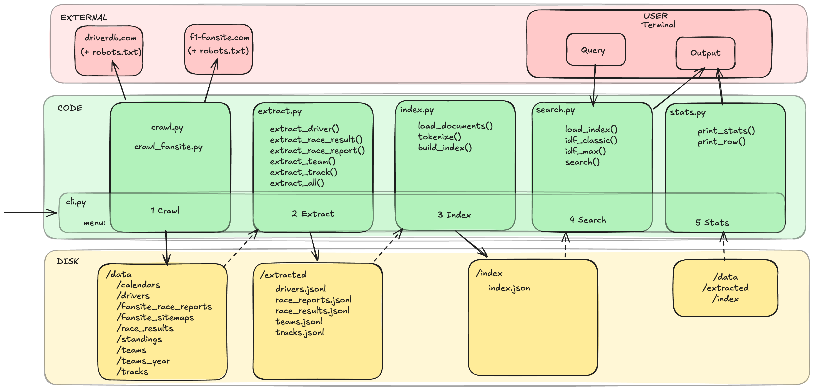
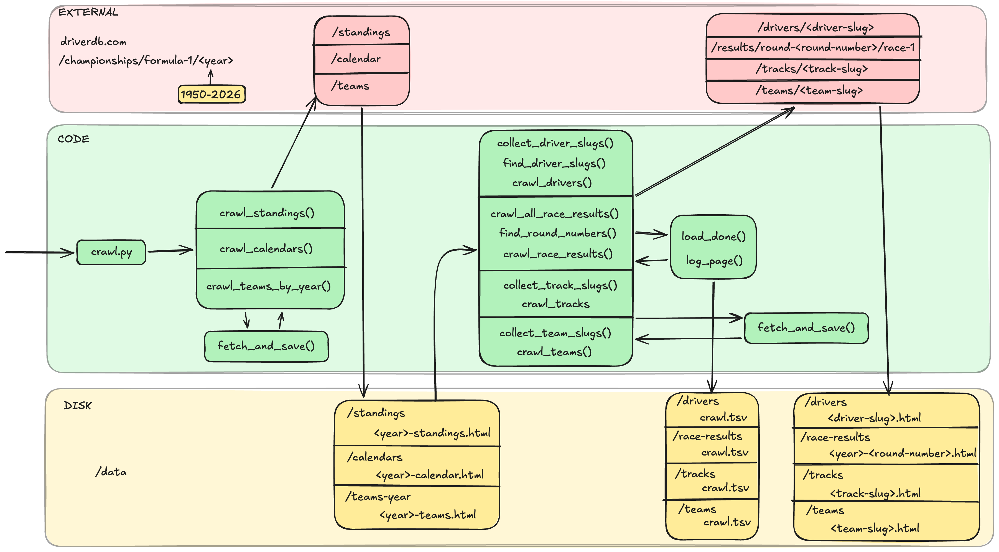
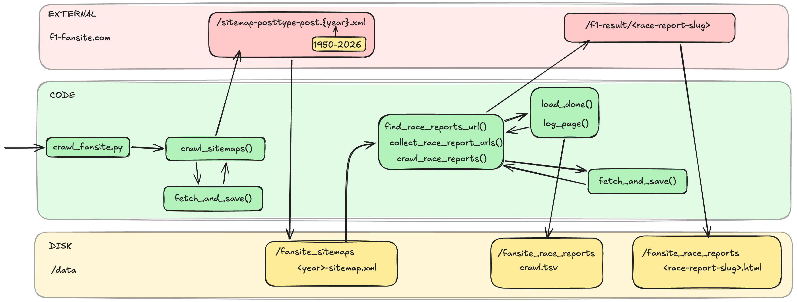

# Odovzdanie 1. časti projektu - Vyhľadávač Formuly 1 (1950 - 2026)

## Opis projektu, čo je cieľom

Cieľom projektu je vyhľadávač nad históriou Formuly 1 od prvej sezóny 1950 po sezónu 2026. Používateľ zadá voľný text, napr. `abu dhabi 2021` alebo `senna prost collision suzuka`, a dostane zoradený zoznam dokumentov. Pri každom výsledku vidí typ dokumentu, skóre, kľúčové údaje (napr. dátum, okruh a víťaza pretekov) a úryvok textu okolo hľadaných slov.

Dáta pochádzajú z dvoch webov, ktoré sa navzájom dopĺňajú:

- **driverdb.com** - štruktúrované dáta: profily jazdcov, výsledkové listiny pretekov, tímy a okruhy.
- **f1-fansite.com** - textové reporty z pretekov: článok o priebehu pretekov, počasie a výsledková tabuľka.

**Motivácia.** Na driverdb.com sa dá prezerať iba sezóna po sezóne alebo jazdec po jazdcovi, f1-fansite.com má reporty iba ako blogové články zoradené podľa dátumu. Otázky naprieč zdrojmi a rokmi, napr. „pri ktorých pretekoch odstúpil jazdec pre poruchu prevodovky“ alebo „čo sa stalo medzi Sennom a Prostom na Suzuke“, sa na žiadnom z nich položiť nedajú.

**Druhá časť projektu** prepojí dokumenty s anglickou Wikipédiou (spracovanie dumpu v Sparku) a index sa prebuduje v PyLucene.

## Scrapované stránky a extrahované dáta

| Web | Typ dokumentu | URL | Počet |
| --- | --- | --- | --- |
| [driverdb.com](https://www.driverdb.com) | jazdec | [`/drivers/<slug>`](https://www.driverdb.com/drivers/ayrton-senna) | 902 |
| | výsledky pretekov | [`/championships/formula-1/<rok>/results/round-<n>/race-1`](https://www.driverdb.com/championships/formula-1/1957/results/round-5/race-1) | 1 020 |
| | tím | [`/teams/<slug>`](https://www.driverdb.com/teams/mclaren) | 228 |
| | okruh | [`/tracks/<slug>`](https://www.driverdb.com/tracks/suzuka) | 87 |
| [f1-fansite.com](https://www.f1-fansite.com) | report z pretekov | [`/f1-result/<slug>/`](https://www.f1-fansite.com/f1-result/results-1989-formula-1-grand-prix-of-japan/) | 1 166 |

Z každej stiahnutej stránky vznikne jeden dokument v `extracted/<typ>.jsonl` (jeden JSON na riadok). Každý dokument má navyše pole `text`, ktoré sa indexuje (poskladané z extrahovaných polí), a `source_url`. Nižšie je jedna ukážka za každý typ.

**1. Jazdec** - [Ayrton Senna](https://www.driverdb.com/drivers/ayrton-senna)

```json
{
  "id": "driver:ayrton-senna",
  "type": "driver",
  "name": "Ayrton Senna",
  "birth_date": "1960-03-21",
  "death_date": "1994-05-01",
  "nationality": "Brazilian",
  "f1_titles": [1988, 1990, 1991],
  "awards": ["1991 FIA Formula One World Championship", "1990 FIA Formula One World Championship", "..."],
  "place_of_birth": "São Paulo",
  "place_of_death": "Bologna, Italy",
  "f1_stats": {"races": 149, "wins": 39, "podiums": 75, "poles": 64},
  "source_url": "https://www.driverdb.com/drivers/ayrton-senna",
  "text": "Ayrton Senna Brazilian São Paulo Bologna, Italy 1988 Formula 1 World Champion ..."
}
```

**2. Výsledky pretekov** - [Veľká cena Británie 1957](https://www.driverdb.com/championships/formula-1/1957/results/round-5/race-1)

```json
{
  "id": "race:1957-round-5",
  "type": "race_result",
  "year": 1957,
  "round": 5,
  "name": "British Grand Prix",
  "date": "1957-07-20",
  "track": "Aintree Motor Racing Circuit",
  "winner": "Tony Brooks / Stirling Moss",
  "results": [
    {"position": 1, "driver": "Tony Brooks", "driver_slug": "tony-brooks", "team": "Vanwall",
     "car_number": "20", "grid": 1, "laps": 90, "points": 4.0, "status": "finished"},
    {"position": 1, "driver": "Stirling Moss", "driver_slug": "stirling-moss", "team": "Vanwall",
     "car_number": "20", "grid": 3, "laps": 90, "points": 5.0, "status": "finished"},
    "..."
  ],
  "source_url": "https://www.driverdb.com/championships/formula-1/1957/results/round-5/race-1",
  "text": "British Grand Prix 1957 Aintree Motor Racing Circuit winner Tony Brooks / Stirling Moss..."
}
```

**3. Report z pretekov** - [Veľká cena Japonska 1989](https://www.f1-fansite.com/f1-result/results-1989-formula-1-grand-prix-of-japan/)

```json
{
  "id": "report:results-1989-formula-1-grand-prix-of-japan",
  "type": "race_report",
  "title": "1989 Japanese F1 Grand Prix Race Report & Results",
  "date": "1989-10-22",
  "year": 1989,
  "event": "Japanese Grand Prix",
  "track": "Suzuka Circuit",
  "weather": "overcast, mild, dry",
  "winner": "Alessandro Nannini",
  "results": [
    {"position": 1, "car_number": "19", "driver": "Alessandro Nannini", "team": "Benetton",
     "grid": 6, "laps": 53, "time": "1:35:06.277", "points": 9.0, "status": "finished"},
    "..."
  ],
  "article": "Event: Japanese Grand Prix Track: Suzuka Circuit Weather: overcast, mild, dry Alessandro Nannini won his 1st F1 World Championship race at the 1989 Japanese F1 ...",
  "source_url": "https://www.f1-fansite.com/f1-result/results-1989-formula-1-grand-prix-of-japan/",
  "text": "1989 Japanese F1 Grand Prix Race Report & Results Event: Japanese Grand Prix Track: Suzuka..."
}
```

**4. Tím** - [McLaren](https://www.driverdb.com/teams/mclaren)

```json
{
  "id": "team:mclaren",
  "type": "team",
  "name": "McLaren",
  "full_name": "McLaren Mastercard F1 Team",
  "country": "Great Britain",
  "headquarters": "Woking",
  "principal": "Andrea Stella",
  "description": "McLaren entered Formula 1 in 1966, founded by New Zealander Bruce McLaren, who had already made his name as a driver and engineer. ...",
  "source_url": "https://www.driverdb.com/teams/mclaren",
  "text": "McLaren McLaren Mastercard F1 Team Great Britain Woking Andrea..."
}
```

**5. Okruh** - [Suzuka](https://www.driverdb.com/tracks/suzuka)

```json
{
  "id": "track:suzuka",
  "type": "track",
  "name": "Suzuka International Racing Course",
  "country": "JP",
  "latitude": 34.8431,
  "longitude": 136.541,
  "description": "Suzuka Circuit is a famous motor racing circuit located in Suzuka, Japan. It opened in 1962 and was originally built as a test track for Honda. ...",
  "layouts": [
    {"name": "Grand Prix Circuit 2003", "length_meters": 5807, "active_from": 2003, "active_to": null},
    {"name": "Grand Prix Circuit 2002", "length_meters": 5821, "active_from": 2002, "active_to": 2002},
    "..."
  ],
  "source_url": "https://www.driverdb.com/tracks/suzuka",
  "text": "Suzuka International Racing Course JP Suzuka Circuit..."
}
```

## Otázky a odpovede

Otázky, ktoré by mal systém zodpovedať. Stĺpec **Dopyt** je text zadaný do vyhľadávača, **Skutočný výsledok** je pozícia očakávaného dokumentu vo výsledkoch (IDF classic / IDF max) a čo je na prvom mieste.

| # | Otázka | Očakávaná odpoveď | Dopyt | Skutočný výsledok |
| --- | --- | --- | --- | --- |
| 1 | Kto vyhral Veľkú cenu Abú Zabí 2021? | Max Verstappen (report a výsledky pretekov) | `who won abu dhabi 2021` | 1. / 1. - report 2021 Abu Dhabi, `winner: Max Verstappen`; na 2. mieste výsledky z driverdb.com |
| 2 | Koľko pretekov vyhral Oscar Piastri? | 12 (profil jazdca) | `oscar piastri wins` | 1. / 1. - profil jazdca s `wins: 12`, pod ním jeho víťazné preteky (Belgicko 2025, Miami 2025) |
| 3 | Čo sa stalo medzi Sennom a Prostom na Suzuke 1989? | report z VC Japonska 1989 (kolízia, diskvalifikácia Sennu) | `senna prost collision suzuka 1989` | 2. / 2. - na 1. mieste VC Austrálie 1989, ktorá spomína rovnakú kolíziu |
| 4 | Kde sa narodil Ayrton Senna? | São Paulo (profil jazdca) | `where was ayrton senna born` | 3. / 3. - pred ním dva reporty so slovom „born“ v článku; profil má v poli `born: 1960-03-21 São Paulo` |
| 5 | Kde sídli tím Ferrari? | Maranello (tím) | `ferrari headquarters maranello` | 2. / 5. - na 1. mieste tím Haas: jeho popis obsahuje slovo „headquarters“, popis Ferrari nie (sídlo Ferrari driverdb.com neuvádza) |
| 6 | Ako dlhý je okruh v Monze? | 5793 m (okruh) | `how long is monza circuit` | 3. / 3. - na 1. mieste okruh v Šanghaji |
| 7 | Kto je šéfom tímu McLaren? | Andrea Stella (tím) | `mclaren team principal` | 18. / 29. - na 1. mieste report VC Maďarska 2024, ktorého úryvok odpoveď obsahuje („Team Principal Andrea Stella“) |
| 8 | Koľko titulov získal Juan Manuel Fangio? | 5 (profil jazdca) | `juan manuel fangio titles` | ani v top 50 - profil prehrá s výsledkami pretekov, v ktorých sa jeho meno opakuje |

**Zhodnotenie.** Otázky na konkrétne preteky systém zodpovedá dobre, pretože rok a názov Veľkej ceny sú zriedkavé termy. Slabé miesto sú otázky na profil entity: profil Fangia má 456 tokenov (dlhý zoznam ocenení) a jeho meno je v ňom raz, kým výsledková listina z 50. rokov je kratšia a meno obsahuje viackrát. Riešením by bola váha podľa poľa (zhoda v mene alebo titulku má väčšiu váhu ako zhoda v texte) - to plánujeme v druhej časti s PyLucene. Agregačné otázky typu „vymenuj všetky víťazstvá jazdca“ TF-IDF nezodpovie, vráti iba jednotlivé dokumenty.

## Frameworky a knižnice

| Nástroj | Na čo | Prečo |
| --- | --- | --- |
| Python 3.14 | celý projekt | |
| `uv` | virtuálne prostredie, závislosti (`pyproject.toml`, `uv.lock`) | rýchly, verzie zamknuté v `uv.lock` |
| `requests` | HTTP requesty | jediná externá knižnica crawlera, jednoduché hlavičky a timeout |
| `re` | extrakcia URL aj entít | stránky majú jednotnú šablónu, všetko potrebné sa dá vytiahnuť regexom |
| `urllib.robotparser` | čítanie robots.txt | štandardná knižnica |
| `json`, `html`, `unicodedata` | zápis JSONL a indexu, dekódovanie HTML entít, odstránenie diakritiky | štandardná knižnica |
| `argparse` | CLI (`crawl`, `extract`, `index`, `search`, `stats`) | štandardná knižnica |
| `pytest` | unit testy extraktorov (bonus) | |
| `tiktoken` | počet tokenov v štatistike (bonus) | tokenizer modelov GPT |

Spustenie: `uv run src/cli.py` (menu) alebo `uv run src/cli.py <príkaz>`, napr. `uv run src/cli.py search abu dhabi 2021 --idf compare`.

## Architektúra crawlovacieho systému

Celý systém je reťazec krokov, každý číta iba súbory uložené predchádzajúcim krokom:

```text
crawl (crawl.py, crawl_fansite.py) ->  data/<typ>/*.html + crawl.tsv -> 
extract (extract.py) ->  extracted/<typ>.jsonl -> 
index (index.py) ->  index/index.json -> 
search (search.py) ->  výsledky v termináli
```



Všetky kroky sa spúšťajú cez `cli.py` (menu 1 - 5 alebo príkazy `crawl`, `extract`, `index`, `search`, `stats`). Podrobnosti crawlu pre oba weby sú na diagramoch nižšie.

Kroky sa dajú spúšťať samostatne, pád jedného kroku nezničí výsledky predchádzajúcich a crawl sa dá prerušiť a znova spustiť (už stiahnuté stránky sa preskočia podľa logu).

Crawler má dva druhy stránok:

- **pomocné stránky** (jedna na rok, 1950 - 2026) slúžia iba ako zdroj odkazov a neindexujú sa: na driverdb.com `standings` (odkazy na jazdcov), `calendar` (čísla kôl a odkazy na okruhy), `teams` (odkazy na tímy); na f1-fansite.com ročné sitemapy `sitemap-posttype-post.<rok>.xml` (odkazy na reporty),
- **stránky entít**: samotné dokumenty.

### driverdb.com ([`crawl.py`](src/crawl.py))



| Zdroj | Čo z neho extrahujeme | Cieľová stránka |
| --- | --- | --- |
| `/<rok>/standings` | slugy jazdcov (`profile_url` v JSON) | `/drivers/<slug>` |
| `/<rok>/calendar` | čísla pretekov | `/<rok>/results/round-<n>/race-1` |
| `/<rok>/calendar` | slugy okruhov | `/tracks/<slug>` |
| `/<rok>/teams` | slugy tímov | `/teams/<slug>` |

### f1-fansite.com ([`crawl_fansite.py`](src/crawl_fansite.py))



Ročné sitemapy obsahujú 2599 rôznych odkazov na `/f1-result/…`. Okrem reportov z pretekov sú medzi nimi aj kvalifikácie, tréningy, sprinty a testy; tie odfiltrujeme podľa slov v slugu (`quali`, `grid`, `practice`, `fp1`) a stiahneme 1166 reportov.

### Zistenia počas crawlovania

- **Menu „Popular Drivers“.** Každá stránka driverdb.com má v hlavičke odkazy na aktuálnych jazdcov, preto jazdcov berieme iba z poľa `profile_url` v dátach tabuľky, nie zo všetkých odkazov `/drivers/`.
- **Slugy nie sú vždy malými písmenami bez diakritiky** (`Écurie-rosier`, `enrico-platé`), preto ich nemeníme.
- **Web sa mení aj po crawle.** Testy nemusia byť aktuálne, keďže stále prebieha sezóna 2026 a údaje o jazdcoch sa môžu meniť.

## Metadáta ukladané pri crawlovaní

Každý typ stránky entít má vlastný log `data/<typ>/crawl.tsv`. Po každom requeste sa doň pripíše riadok:

| status | key | path | url |
| --- | --- | --- | --- |
| 200 | `adolf-brudes` | `data/drivers/adolf-brudes.html` | `https://www.driverdb.com/drivers/adolf-brudes` |
| 200 | `1951-round-1` | `data/race_results/1951-1.html` | `https://www.driverdb.com/championships/formula-1/1951/results/round-1/race-1` |
| 200 | `albert-park` | `data/tracks/albert-park.html` | `https://www.driverdb.com/tracks/albert-park` |
| 200 | `alpine` | `data/teams/alpine.html` | `https://www.driverdb.com/teams/alpine` |
| 200 | `2025-austrian-f1-grand-prix-race-report-results` | `data/fansite_race_reports/2025-2025-austrian-f1-grand-prix-race-report-results.html` | `https://www.f1-fansite.com/f1-result/2025-austrian-f1-grand-prix-race-report-results/` |
| 410 | *(15 jazdcov)* | - | stránka bola z webu odstránená |

Na čo slúžia:

- **status** - pri ďalšom spustení sa preskočia kľúče so statusom 200, chybné stránky sa skúsia znova; extraktor číta iba stránky so statusom 200,
- **key** - jednoznačný kľúč stránky (slug alebo `<rok>-round-<n>`), z neho vzniká `id` dokumentu,
- **path** - kde je HTML na disku,
- **url** - zdroj, prenáša sa do dokumentu ako `source_url` a zobrazuje sa vo výsledkoch.

## Hlavičky, timeouty, sleepy

| Nastavenie | Hodnota | Prečo |
| --- | --- | --- |
| `User-Agent` | `VINF-F1-crawler/0.1 (FIIT STU student project)` | správca webu vidí, kto crawluje a prečo; robots.txt sa vyhodnocuje pre tento User-Agent |
| robots.txt | stiahne sa raz pre každý web, každá URL sa overí cez `can_fetch` | zakázané URL sa nestiahnu (napr. `/wp-admin/` na f1-fansite.com) |
| pauza medzi requestmi | `Crawl-delay` z robots.txt, ak chýba, tak 2 s | ani jeden web `Crawl-delay` pre všetkých agentov nedefinuje; 2 s je ohľaduplná hodnota pre malé weby a celý crawl (~3 700 stránok) aj tak zbehne za ~2,5 hodiny |
| timeout requestu | 10 s | stránky majú 200 - 400 kB a bežne prídu do 1 s; dlhšie čakanie znamená problém na strane servera |
| opakovanie | max. 3 pokusy pri sieťovej chybe, 429 a 5xx, s čakaním 2 s a 4 s | dočasné chyby sa oplatí skúsiť znova, s rastúcou pauzou, aby sme preťažený server nezaťažovali ďalej |
| 404, 410 a iné 4xx | bez opakovania, iba zápis do logu | stránka neexistuje, opakovanie nepomôže |

Obsah robots.txt oboch webov (pre `User-agent: *`):

| Web | Disallow | Crawl-delay |
| --- | --- | --- |
| driverdb.com | `/api/` | nie je |
| f1-fansite.com | `/wp-admin/`, `/?s=` (vyhľadávanie), časti `/f1-merchandise/` | nie je |

Žiadna z našich URL nie je zakázaná.

Kód: [`get_robots`](src/common.py#L13), [`crawl_delay`](src/common.py#L28), [`fetch_and_save`](src/common.py#L34) v [`common.py`](src/common.py)

## Kód na extrakciu URL z HTML

Odkazy hľadáme regexom na uložených pomocných stránkach. `set` odstráni duplikáty (ten istý jazdec je v tabuľke viackrát).

**Slugy jazdcov zo stránky standings** ([`find_driver_slugs` - `crawl.py`](src/crawl.py#L57)). Dáta tabuľky sú v stránke ako escapovaný JSON, preto `\\"`:

```python
def find_driver_slugs(html):
    # set takes care of duplicates
    pattern = r'profile_url\\":\\"/drivers/([^\\]+)'
    slugs = set(re.findall(pattern, html))
    return sorted(slugs)
```

**Čísla kôl z kalendára** ([`find_round_numbers` - `crawl.py`](src/crawl.py#L132)). Z čísla kola potom skladáme URL `…/round-<n>/race-1`:

```python
def find_round_numbers(html, year):
    pattern = rf'href="/championships/formula-1/{year}/results/round-(\d+)"'
    rounds = set(re.findall(pattern, html))
    round_numbers = []
    for r in rounds:
        round_numbers.append(int(r))
    return sorted(round_numbers)
```

**Reporty zo sitemapy f1-fansite.com** ([`find_race_report_urls` - `crawl_fansite.py`](src/crawl_fansite.py#L44)):

```python
EXCLUDED_WORDS = ["quali", "grid", "practice", "lap-times", "sprint", "test"]

def find_race_report_urls(xml):
    pattern = r'<loc>(https://www\.f1-fansite\.com/f1-result/[^<]+)</loc>'
    urls = set(re.findall(pattern, xml))
    race_urls = []
    for url in urls:
        slug = url.split("/f1-result/")[1]
        # Skip non-race posts
        if any(word in slug for word in EXCLUDED_WORDS):
            continue
        # Skip practice posts named fp1, fp2, fp3
        if re.search(r'fp\d', slug):
            continue
        race_urls.append(url)
    return sorted(race_urls)
```

## Kód na extrakciu entít z HTML

Kód: [`extract.py`](src/extract.py) ([jazdec](src/extract.py#L92), [riadky reportu](src/extract.py#L270)). Pre každý typ dokumentu je sekcia s regexmi, funkcia `extract_<typ>(html, key)`, ktorá vráti slovník polí, a funkcia `<typ>_text`, ktorá poskladá text na indexovanie. Spoločná funkcia `extract_pages` prejde všetky stránky so statusom 200 z logu a zapíše JSONL.

Dáta sú na stránkach v niekoľkých formátoch a regexy sa podľa toho líšia:

| Formát | Kde | Príklad vstupu (z uloženej stránky) | Regex | Výstup |
| --- | --- | --- | --- | --- |
| JSON-LD (`<script type="application/ld+json">`) | driverdb.com: jazdec, tím, okruh | `"@type":"Person",…,"name":"Ayrton Senna"` | `"name":"([^"]+)"` | `Ayrton Senna` |
| escapovaný JSON (Next.js) | driverdb.com: výsledky, štatistiky, sídlo tímu, rozloženia | `\"headquarters\":\"Woking\"` | `\\"headquarters\\":\\"([^"\\]+)\\"` | `Woking` |
| HTML (WordPress) | f1-fansite.com: report | `Weather: <i class="fa fa-cloud-sun"></i> overcast, mild, dry</p>` | `Weather:(?:</strong>)?\s*(.*?)(?:<br\|</p>)` + odstránenie tagov | `overcast, mild, dry` |
| `<title>` | tím bez JSON-LD | `<title>Écurie Rosier – Results, Stats &amp; Race History` | `<title>([^<]+?) – ` | `Écurie Rosier` |

**Jazdec** - regexy a extrakcia:

```python
# JSON-LD block with the page's main person (plain JSON, not escaped)
DRIVER_PERSON_RE = re.compile(r'"@type":"Person",(.*?)</script>')
DRIVER_NAME_RE = re.compile(r'"name":"([^"]+)"')
DRIVER_BIRTH_DATE_RE = re.compile(r'"birthDate":"([^"]+)"')
DRIVER_DEATH_DATE_RE = re.compile(r'"deathDate":"([^"]+)"')
DRIVER_NATIONALITY_RE = re.compile(r'"nationality":\{"@type":"Country","name":"([^"]+)"')
DRIVER_AWARDS_RE = re.compile(r'"award":\[(.*?)\]')
DRIVER_AWARD_ITEM_RE = re.compile(r'"([^"]+)"')
DRIVER_F1_TITLE_RE = re.compile(
    r'^(\d{4}) (FIA World Championship of Drivers|FIA World Championship Formula One'
    r'|FIA Formula One World Championship|FIA Formula 1 World Championship)$'
)
# Escaped NEXT.JS JSON - the page has records of several drivers, so we create a link back to the driver
DRIVER_PLACES_RE = (
    r'\\"place_of_birth\\":(?:\\"([^"]*?)\\"|null),\\"dod\\":[^,]*,'
    r'\\"place_of_death\\":(?:\\"([^"]*?)\\"|null),\\"ddb_url\\":\\"{slug}\\"'
)
# F1 stats block (the page also has stats from other series)
DRIVER_F1_STATS_RE = re.compile(
    r'\\"legacy_url\\":\\"formula-1\\",\\"championship_id\\":1,\\"stats\\":'
    r'{\\"races\\":(\d+),\\"wins\\":(\d+),\\"podiums\\":(\d+),\\"poles\\":(\d+)'
)

# Extract driver fields from the driver HTML page
def extract_driver(html, slug):
    person = first_match(DRIVER_PERSON_RE, html) or ""

    awards = []
    awards_block = first_match(DRIVER_AWARDS_RE, person)
    if awards_block:
        awards = DRIVER_AWARD_ITEM_RE.findall(awards_block)

    f1_titles = []
    for award in awards:
        match = DRIVER_F1_TITLE_RE.match(award)
        if match:
            f1_titles.append(int(match.group(1)))

    place_of_birth = None
    place_of_death = None
    places = re.search(DRIVER_PLACES_RE.format(slug=re.escape(slug)), html)
    if places:
        place_of_birth = clean_value(places.group(1))
        place_of_death = clean_value(places.group(2))

    f1_stats = {}
    stats = DRIVER_F1_STATS_RE.search(html)
    if stats:
        f1_stats = {
            "races": int(stats.group(1)),
            "wins": int(stats.group(2)),
            "podiums": int(stats.group(3)),
            "poles": int(stats.group(4)),
        }

    return {
        "id": f"driver:{slug}",
        "type": "driver",
        "name": first_match(DRIVER_NAME_RE, person),
        "birth_date": first_match(DRIVER_BIRTH_DATE_RE, person),
        "death_date": first_match(DRIVER_DEATH_DATE_RE, person),
        "nationality": first_match(DRIVER_NATIONALITY_RE, person),
        "f1_titles": sorted(f1_titles),
        "awards": awards,
        "place_of_birth": place_of_birth,
        "place_of_death": place_of_death,
        "f1_stats": f1_stats,
    }
```

Tituly majstra sveta nie sú na stránke ako samostatné pole, sú medzi oceneniami (`award`) spolu s titulmi z iných sérií. Regex `DRIVER_F1_TITLE_RE` vyberie iba ocenenia F1, ktoré mali v priebehu rokov štyri rôzne názvy.

**Report** - riadky výsledkovej tabuľky z f1-fansite.com:

```python
REPORT_TABLE_RE = re.compile(r'<table class="motor-sport-results msr_result[^"]*">(.*?)</table>', re.DOTALL)
REPORT_ROW_RE = re.compile(r'<tr[^>]*>(.*?)</tr>', re.DOTALL)
REPORT_ROW_POSITION_RE = re.compile(r'msr-rank-badge">(\d+)<')
REPORT_ROW_DRIVER_RE = re.compile(r'class="msr-driver-name[^"]*"[^>]*aria-label="([^"]+)"')
# Team cell has two markups (with and without msr-result-team span), anchor on the col
REPORT_ROW_TEAM_RE = re.compile(r'<td class="msr_col4">.*?<a [^>]*>([^<]+)</a>', re.DOTALL)
# ... (number, grid, laps, status, time, points)

# Extract result rows from the f1-fansite results table
def extract_report_results(html):
    table = first_match(REPORT_TABLE_RE, html)
    if table is None:
        return []
    results = []
    for row in REPORT_ROW_RE.findall(table):
        # Skip header
        driver = first_match(REPORT_ROW_DRIVER_RE, row)
        if driver is None:
            continue
        results.append({
            "position": first_number(REPORT_ROW_POSITION_RE, row),
            "car_number": first_match(REPORT_ROW_NUMBER_RE, row),
            "driver": clean_html_text(driver),
            "team": clean_html_text(first_match(REPORT_ROW_TEAM_RE, row)),
            "grid": first_number(REPORT_ROW_GRID_RE, row),
            "laps": first_number(REPORT_ROW_LAPS_RE, row),
            "time": clean_html_text(first_match(REPORT_ROW_TIME_RE, row)),
            "points": first_number(REPORT_ROW_POINTS_RE, row, float),
            "status": first_match(REPORT_ROW_STATUS_RE, row) or "finished"
        })
    return results
```

### Obmedzenia dát

- Výsledky pretekov na driverdb.com chýbajú pre sezóny 1982 - 1990, sezóna 1981 má 12 z 15 pretekov. Reporty z f1-fansite.com pokrývajú všetky roky 1950 - 2026, takže tieto preteky sa dajú nájsť aspoň cez report.
- 42 % záznamov vo výsledkoch pretekov (9625 z 22968), takmer všetky z rokov 1991 - 2014, nemá tím. driverdb.com má v dátach `"team":null` a názov tímu nie je nikde na stránke. Report z tých istých pretekov tím má.
- Report VC San Marína 1999 nemá výsledkovú tabuľku pretekov (iba priebežné poradie), preto nemá víťaza.

## Indexer a index (TF)

Kód: [`index.py`](src/index.py) ([`tokenize`](src/index.py#L20), [`build_index`](src/index.py#L84))

**Tokenizácia** (`tokenize`): text sa zmení na malé písmená, odstráni sa diakritika (NFKD normalizácia, `São Paulo` → `sao paulo`), rozdelí sa na slová regexom `[a-z0-9]+` a vynechá sa 37 anglických stop slov (`the`, `and`, `who`, ...).

**Invertovaný index** (`build_index`): pre každý term slovník `doc_id → tf`, kde tf je počet výskytov termu v poli `text` dokumentu. Popri tom sa ukladá dĺžka každého dokumentu v tokenoch.

```python
# Inverted index: term -> doc_id -> term frequency
def build_index(docs):
    index = {}
    doc_lengths = {}
    for doc in docs:
        tokens = tokenize(doc["text"])
        doc_lengths[doc["id"]] = len(tokens)
        for token in tokens:
            postings = index.setdefault(token, {})
            postings[doc["id"]] = postings.get(doc["id"], 0) + 1
    return index, doc_lengths
```

Index sa uloží do `index/index.json` (28 MB):

```json
{
  "N": 3403,
  "docs": {"driver:ayrton-senna": {"type", "title", "url", "fields", "text"}, ...},
  "doc_lengths": {"driver:ayrton-senna": 98, ...},
  "index": {"senna": {"driver:ayrton-senna": 1, "report:...": 7, ...}, ...}
}
```

`docs` obsahuje to, čo sa zobrazí vo výsledku (titulok, URL, kľúčové polia a text pre úryvok), takže vyhľadávanie nepotrebuje JSONL ani HTML.

| | |
| --- | --- |
| dokumenty | 3403 |
| termy (slovník) | 19294 |
| tokeny spolu | 731804 |
| priemerná dĺžka dokumentu | 215 tokenov |
| postingy (dvojice term - dokument) | 432517 |
| najčastejšie termy (df) | dnf 2128, grand 2038, prix 2027, ferrari 1776, mclaren 1627 |

**Koľkokrát index vytvárame.** Index sa vždy postaví celý znova z `extracted/*.jsonl` príkazom `uv run src/cli.py index`. Vytvára sa po každej extrakcii - počas vývoja po každej zmene extraktora. Vyhľadávanie ho načíta z disku raz na začiatku a potom už pracuje iba v pamäti.

**Váha TF.** Holé tf delené dĺžkou dokumentu zvýhodňovalo veľmi krátke dokumenty (na dopyt `ayrton senna` vyhral Bruno Senna, ktorého profil je kratší). Preto používame TF so saturáciou a normalizáciou dĺžky voči priemernému dokumentu (TF časť vzorca BM25, k1 = 1,2, b = 0,75): každý ďalší výskyt termu pridá menej ako predchádzajúci a dokumenty dlhšie ako priemer sú mierne penalizované.

Vzorec TF je zlomok zo vzorca Okapi BM25. Z BM25 preberáme iba váhu TF. Jeho IDF `log((N − df + 0,5) / (df + 0,5))` je probabilistické, a preto ho nepoužívame - obe naše metódy IDF (classic a max) sú neprobabilistické.

```text
tf_weight = tf · (k1 + 1) / (tf + k1 · (1 − b + b · dĺžka / priemerná_dĺžka))
skóre(d) = Σ tf_weight(t, d) · idf(t)  ·  (1 + počet termov dopytu v titulku / počet termov dopytu)
```

Posledný člen zvýhodní dokumenty, ktoré majú hľadané slová v titulku (napr. tím `McLaren` pri dopyte `mclaren …`).

```python
def tf_weight(tf, length, data):
    norm = 1 - B + B * length / data["avg_length"]
    return tf * (K1 + 1) / (tf + K1 * norm)

def search(query, data, idf_method, top_k=10):
    idf = IDF_METHODS[idf_method]
    terms = tokenize(query)
    scores = {}
    for term in terms:
        postings = data["index"].get(term)
        if not postings:
            continue
        weight = idf(len(postings), data)
        for doc_id, tf in postings.items():
            length = data["doc_lengths"][doc_id]
            scores[doc_id] = scores.get(doc_id, 0) + tf_weight(tf, length, data) * weight

    # Title boost: documents with query terms in the title rank higher
    for doc_id in scores:
        title_terms = set(tokenize(data["docs"][doc_id]["title"]))
        matched = sum(1 for term in terms if term in title_terms)
        scores[doc_id] *= 1 + matched / len(terms)

    ranked = sorted(scores.items(), key=lambda item: item[1], reverse=True)
    return ranked[:top_k]
```

Kód: [`search.py`](src/search.py) ([`idf_classic`, `idf_max`](src/search.py#L18), [`tf_weight`, `search`](src/search.py#L29))

## Metódy výpočtu IDF

N = 3403 je počet dokumentov, df(t) počet dokumentov, ktoré obsahujú term t, max_df = 2128 je df najčastejšieho termu (`dnf`).

| Metóda | Vzorec | Význam |
| --- | --- | --- |
| **classic** | idf(t) = log(N / df(t)) | zriedkavosť termu voči celej kolekcii |
| **max** | idf(t) = log(max_df / (1 + df(t))) | zriedkavosť termu voči najčastejšiemu termu v kolekcii |

Classic je štandardné IDF. Max je variant „inverse document frequency max“. Probabilistické IDF `log((N − df) / df)` nepoužívame.

```python
# Classic IDF: log(N / df)
def idf_classic(df, data):
    return math.log(data["N"] / df)

# IDF max: log(max_df / (1 + df)), relative to the most common term
def idf_max(df, data):
    return math.log(data["max_df"] / (1 + df))
```

**Rozdiel medzi metódami.** Pre náš dataset platí idf_max(t) ≈ idf_classic(t) − log(N / max_df) = idf_classic(t) − 0,47. IDF max je teda klasická IDF posunutá o konštantu. Pri zriedkavých termoch (idf 2 - 5) je posun malý a poradie dokumentov sa nezmení. Pri častých termoch (`dnf`, `grand`, `prix`, `ferrari`, `mclaren`, `championship`, df > 1600, classic idf ~0,5 - 0,7) klesne idf max takmer na nulu, takže tieto termy prestanú ovplyvňovať poradie. Najčastejší term `dnf` má idf max dokonca mierne záporné (−0,0005), lebo max_df / (1 + max_df) < 1.

| Term | df | idf classic | idf max |
| --- | --- | --- | --- |
| abu, dhabi | 37 | 4,52 | 4,03 |
| suzuka | 122 | 3,33 | 2,85 |
| honda | 356 | 2,26 | 1,79 |
| gearbox | 535 | 1,85 | 1,38 |
| championship | 1617 | 0,74 | 0,27 |
| mclaren | 1627 | 0,74 | 0,27 |
| dnf | 2128 | 0,47 | −0,00 |

## Porovnanie metód IDF na dopytoch

Spustenie: `uv run src/cli.py search <dopyt> --idf compare`. Tabuľky ukazujú top 5 a skóre.

### 1. `mclaren honda championship` - poradie sa zmení

| # | classic | skóre | max | skóre |
| --- | --- | --- | --- | --- |
| 1 | **McLaren** (tím) | 7,18 | **Honda** (tím) | 4,53 |
| 2 | 1968 French F1 GP | 6,17 | McLaren (tím) | 4,12 |
| 3 | 2006 German F1 GP | 5,99 | 1965 Mexican F1 GP | 3,93 |
| 4 | 1968 Italian F1 GP | 5,93 | 1968 French F1 GP | 3,89 |
| 5 | 2006 San Marino F1 GP | 5,92 | 1967 Italian F1 GP | 3,81 |

Pri classic majú `mclaren` a `championship` ešte váhu 0,74, takže vyhrá tím McLaren. Pri max ich váha klesne na 0,27 a o poradí rozhoduje najmä zriedkavejší term `honda` (1,79), preto vyhrá tím Honda a hore sa dostanú reporty z 60. rokov, keď Honda pretekala ako tím (1965 Mexiko - prvé víťazstvo Hondy).

### 2. `gearbox dnf` - poradie sa zmení

| # | classic | skóre | max | skóre |
| --- | --- | --- | --- | --- |
| 1 | **1978 British F1 GP** | 3,95 | **2015 Singapore GP** | 2,28 |
| 2 | 2015 Singapore GP | 3,92 | 1978 British F1 GP | 2,26 |
| 3 | 1977 United States West F1 GP | 3,80 | 1991 United States F1 GP | 2,17 |
| 4 | 1999 Monaco F1 GP | 3,78 | 1977 United States West F1 GP | 2,17 |
| 5 | 1974 Dutch F1 GP | 3,77 | 2012 Singapore GP | 2,16 |

Pri max má `dnf` nulovú váhu, takže dopyt sa správa ako samotný `gearbox`.

### 3. `senna prost collision suzuka` - poradie zostane (kontrolný dopyt)

| # | classic | skóre | max | skóre |
| --- | --- | --- | --- | --- |
| 1 | 1989 Japanese F1 GP | 14,67 | 1989 Japanese F1 GP | 11,81 |
| 2 | 1993 Japanese F1 GP | 14,23 | 1993 Japanese F1 GP | 11,52 |
| 3 | 1990 Japanese F1 GP | 14,00 | 1990 Japanese F1 GP | 11,32 |
| 4 | 1990 Australian F1 GP | 13,86 | 1990 Australian F1 GP | 11,21 |
| 5 | 1988 Japanese F1 GP | 13,77 | 1988 Japanese F1 GP | 11,19 |

Všetky štyri termy sú zriedkavé (df 122 - 450), takže max od každého odpočíta rovnakú konštantu, skóre klesnú približne rovnomerne a poradie sa nezmení. Rovnako sa správa aj `abu dhabi 2021` (classic 44,40 / 33,53 / 28,28, max 39,35 / 29,72 / 25,18, rovnaké poradie). Väčšina bežných dopytov je tohto typu, takže **rozdiel medzi metódami sa prejaví iba vtedy, keď dopyt obsahuje veľmi častý term**.

## Štatistika vycrawlovaných dokumentov

Výstup príkazu `uv run src/cli.py stats` ([`stats.py`](src/stats.py)):

| Typ | Stiahnuté stránky | HTML (MB) | Extrahované (MB) | Dokumenty | Naše tokeny | Tokeny tiktoken |
| --- | --- | --- | --- | --- | --- | --- |
| jazdci | 902 | 248,4 | 0,7 | 902 | 27906 | 50642 |
| výsledky pretekov | 1020 | 351,3 | 4,8 | 1020 | 98472 | 163038 |
| reporty | 1166 | 312,8 | 13,0 | 1166 | 599243 | 1120408 |
| tímy | 228 | 34,7 | 0,1 | 228 | 2800 | 4896 |
| okruhy | 87 | 19,1 | 0,1 | 87 | 3383 | 5860 |
| **spolu** | **3403** | **966,2** | **18,7** | **3403** | **731804** | **1344844** |

Pomocné stránky (iba zdroj odkazov, neindexujú sa):

| Typ | Stiahnuté stránky | HTML (MB) |
| --- | --- | --- |
| standings | 77 | 33,2 |
| calendars | 77 | 23,9 |
| teams po sezónach | 77 | 22,7 |
| sitemapy f1-fansite.com | 77 | 27,2 |
| **spolu** | **308** | **107,1** |

**Spolu stiahnutých 3711 stránok (1073 MB).** Index má 28 MB.

**Relevantné dokumenty.** Relevantných je 3403 stránok entít - z každej vznikne jeden dokument a všetky sú vo vyhľadávaní. 308 pomocných stránok nie je relevantných ako dokumenty, slúžia iba na nájdenie odkazov.

Z 966 MB HTML ostane po extrakcii 18,7 MB (~52× menej) - väčšinu HTML tvoria skripty, štýly a dáta Next.js, ktoré vyhľadávanie nepotrebuje. Reporty tvoria 82 % všetkých tokenov, pretože sú jediným typom s dlhým článkom.

## ZIP s kódom

Kód je priložený ako ZIP súbor: [vinf-project-horvath.zip](vinf-project-horvath.zip).

Obsahuje:

- `src/` - crawler, extraktor, indexer, vyhľadávanie, štatistiku a CLI,
- `tests/` - unit testy a 22 testovacích stránok,
- `assets/` - diagramy architektúry,
- `index/` - hotový index (`index.json`, 28 MB),
- `pyproject.toml`, `uv.lock` - závislosti,
- `odovzdanie1.md` - tento report, `README.md` a `konzultacia2A.md` - reporty z 1. a 2. konzultácie.

Stiahnuté stránky (`data/`, 1,07 GB) ani extrahované dáta (`extracted/`) v ZIP-e nie sú. Index je priložený, takže vyhľadávanie a testy sa dajú spustiť hneď, bez crawlovania:

```text
uv sync
uv run src/cli.py search abu dhabi 2021
uv run pytest
```

Celý postup od začiatku (stiahnutie, extrakcia, index) vznikne spustením týchto krokov v uvedenom poradí:

```text
uv run src/cli.py crawl all
uv run src/cli.py extract
uv run src/cli.py index
```

## BONUS: Počet tokenov (tiktoken)

Posledný stĺpec štatistiky počíta tokeny poľa `text` tokenizerom `tiktoken` s kódovaním `cl100k_base` (GPT-4). tiktoken vráti 1,84× viac tokenov ako náš tokenizer:

- tiktoken ponecháva stop slová (`the`) a interpunkciu (`,`, `.`),
- zriedkavé slová delí na podslová (`Verstappen` → `Ver|st|appen`, `2021` → `202|1`), čo sa v dátach plných mien jazdcov a okruhov prejaví výrazne.

Náš tokenizer je určený na vyhľadávanie (token = celé slovo, ktoré používateľ zadá), tiktoken na jazykové modely (pevný slovník ~100000 častí, ktorými sa dá zakódovať ľubovoľný text).

## BONUS: Unit testy REGEX extraktorov

Súbor: [`tests/test_extract.py`](tests/test_extract.py). 22 testov na 22 uložených stránkach v `tests/pages/` - kópie stránok sú v repozitári, aby testy nezáviseli od `data/` ani od zmien na webe. Očakávané hodnoty sme overili na živom webe, nie z výstupu extraktora.

| Typ | Stránky | Hraničné prípady |
| --- | --- | --- |
| jazdec | Senna, Hamilton, Schumacher, Fangio, Piastri | mŕtvy / žijúci jazdec, miesto narodenia s diakritikou a čiarkou, staré názvy titulov z 50. rokov, jazdec bez titulu |
| výsledky pretekov | 2021-22, 1957-5, 1994-3, 1950-1 | zdieľané víťazné auto, chýbajúci tím, HTML entita v názve |
| report | Abu Dhabi 2021, Japonsko 1989, San Maríno 1994, San Maríno 1999 | info blok, riadky tabuľky, text článku, stránka bez výsledkovej tabuľky |
| tím | McLaren, Ferrari, Williams, Écurie Rosier | všetky polia, chýbajúce polia, stránka bez JSON-LD (názov z `<title>`) |
| okruh | Suzuka, Monza, Silverstone, Aintree, Monako | súradnice, popis, okruh bez súradníc a popisu, historické rozloženia |

Čo testy odhalili:

- **Web sa mení.** Hodnoty na živom webe sa pri 3 stránkach líšili od uložených, tieto stránky sme stiahli znova.